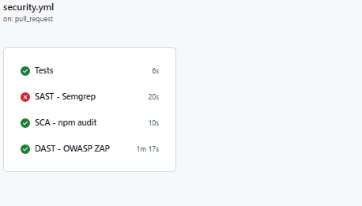
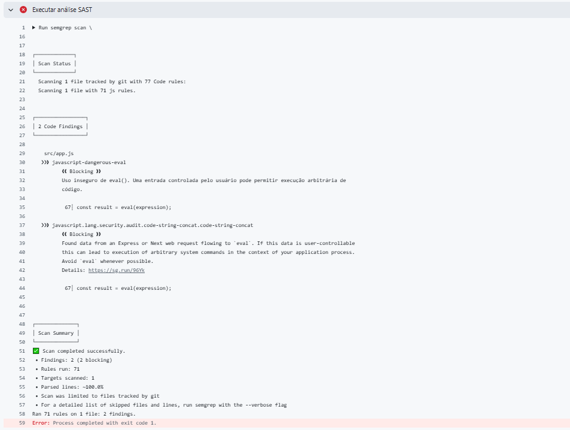
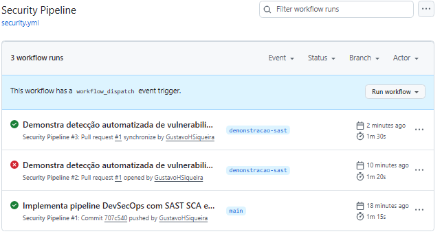

# DevSecOps Security Pipeline

## 1. Sobre o projeto

Este projeto apresenta uma API REST simples de uma loja rural,
desenvolvida com Node.js e Express.

O objetivo é demonstrar a integração automatizada de controles de
segurança ao ciclo de desenvolvimento por meio de uma pipeline de
CI/CD no GitHub Actions.

A aplicação possui endpoints para verificar seu estado e consultar
produtos:

| Método | Endpoint | Descrição |
|---|---|---|
| GET | `/` | Informações da aplicação |
| GET | `/health` | Verificação de disponibilidade |
| GET | `/products` | Lista de produtos |
| GET | `/products/:id` | Consulta um produto por ID |

## 2. Ferramentas utilizadas

| Ferramenta | Finalidade |
|---|---|
| Node.js | Ambiente de execução JavaScript |
| Express | Construção da API |
| Node.js Runner | Execução dos testes automatizados |
| Supertest | Testes dos endpoints HTTP |
| GitHub Actions | Automação da pipeline |
| Semgrep | Análise estática de segurança |
| npm audit | Análise de dependências |
| OWASP ZAP | Análise dinâmica de segurança |
| Docker | Execução isolada da aplicação |

## 3. Tipos de análise

### SAST — Semgrep

O Semgrep realiza análise estática do código-fonte sem executar a
aplicação.

A ferramenta procura padrões potencialmente inseguros, incluindo:

- uso de `eval()`;
- execução insegura de comandos;
- segredos escritos diretamente no código;
- outros padrões inseguros de JavaScript.

### SCA — npm audit

O `npm audit` analisa as dependências registradas no
`package-lock.json` e compara suas versões com uma base de
vulnerabilidades conhecidas.

A pipeline é bloqueada quando são encontradas vulnerabilidades de
severidade alta ou crítica.

### DAST — OWASP ZAP

O OWASP ZAP analisa a aplicação enquanto ela está em execução.

A pipeline:

1. constrói a imagem Docker;
2. inicia a aplicação;
3. verifica o endpoint `/health`;
4. executa o ZAP Baseline;
5. gera relatórios em HTML, JSON e Markdown.

## 4. Funcionamento da pipeline

A pipeline está definida em:

```text
.github/workflows/security.yml
```

Ela é executada automaticamente quando ocorre:

- push nas branches `main` ou `develop`;
- pull request direcionado à branch `main`;
- acionamento manual pelo GitHub Actions.

O fluxo implementado é:

```text
Alteração no código
        ↓
Commit
        ↓
Push ou pull request
        ↓
GitHub Actions
        ↓
Testes + SAST + SCA + DAST
        ↓
PASS ou FAIL
```

## 5. Critérios de segurança

| Controle | Ferramenta | Condição de falha |
|---|---|---|
| Testes | Node.js Test Runner e Supertest | Um ou mais testes falham |
| SAST | Semgrep | Finding bloqueante no código |
| SCA | npm audit | Vulnerabilidade alta ou crítica |
| DAST | OWASP ZAP | Alerta configurado como FAIL |

Se um controle de segurança falhar, a pipeline fica vermelha e a
alteração não deve ser aprovada até que o problema seja tratado.

## 6. Execução local

### Instalar as dependências

```bash
npm ci
```

### Executar os testes

```bash
npm test
```

### Executar a análise de dependências

```bash
npm audit --audit-level=high
```

### Iniciar a aplicação

```bash
npm start
```

A aplicação estará disponível em:

```text
http://localhost:3000
```

### Criar a imagem Docker

```bash
docker build -t rural-store-api .
```

### Executar o container

```bash
docker run --rm -p 3000:3000 rural-store-api
```

## 7. Resultados e evidências

### Vulnerabilidade encontrada pelo SCA

Durante a análise inicial, o `npm audit` identificou 19 ocorrências
de uma vulnerabilidade moderada no pacote transitivo `sprintf-js`.

A dependência era introduzida pela árvore do Jest e não fazia parte
das dependências utilizadas pela aplicação em produção. Como não
havia versão corrigida disponível e a correção forçada instalaria
uma versão incompatível do Jest, o tratamento adotado foi substituir
o Jest pelo executor de testes nativo do Node.js.

Depois da remoção do Jest, os testes continuaram funcionando e uma
nova execução do `npm audit` confirmou a remoção da dependência
vulnerável.


### Pipeline bloqueada

A imagem abaixo demonstra a execução em que o Semgrep encontrou uma
vulnerabilidade e bloqueou a pipeline.



### Finding apresentado pelo Semgrep

A imagem abaixo mostra os detalhes do padrão inseguro encontrado.



### Pipeline depois da correção

Depois da remoção do código inseguro, uma nova execução foi iniciada
automaticamente.



## 8. Tratamento da vulnerabilidade

Para demonstrar o funcionamento do controle SAST, foi introduzido
temporariamente um endpoint que utilizava `eval()` sobre uma entrada
recebida do usuário.

O Semgrep identificou o uso inseguro e bloqueou a pipeline.

Depois do registro da evidência, o endpoint vulnerável foi removido.
Uma nova execução confirmou que o problema havia sido corrigido.

A vulnerabilidade não permanece na versão final da aplicação.

## 9. Relatórios produzidos

A pipeline disponibiliza os seguintes artefatos:

| Artefato | Conteúdo |
|---|---|
| `semgrep-report` | Findings da análise estática |
| `npm-audit-report` | Resultado da análise de dependências |
| `zap-report` | Relatórios HTML, JSON e Markdown do DAST |

Os relatórios podem ser baixados na página da execução do GitHub
Actions.

## 10. DevSecOps e Shift Left

A implementação aplica DevSecOps porque a segurança faz parte do mesmo
processo automatizado usado para testar e validar o código.

O conceito de Shift Left é aplicado porque as verificações SAST e SCA
são executadas imediatamente após um push ou pull request. Dessa
maneira, os problemas são encontrados durante o desenvolvimento, antes
que o código seja disponibilizado em produção.

A análise DAST complementa os controles ao verificar o comportamento
da aplicação em execução.

## 11. Conclusão

A atividade demonstra que controles de segurança podem ser incorporados
ao processo de desenvolvimento de forma contínua e automatizada.

Caso uma vulnerabilidade relevante seja encontrada, a pipeline falha e
sinaliza que o problema precisa ser corrigido. Depois da correção, uma
nova análise é executada automaticamente, fornecendo evidência de que o
código passou pelos controles definidos.